# robotic milling station with a pneumatic clamping cylinder

Design and simulation of an automated machining cell: a steel articulated robot mills a workpiece held by a double-acting pneumatic clamping cylinder on a custom fixture.

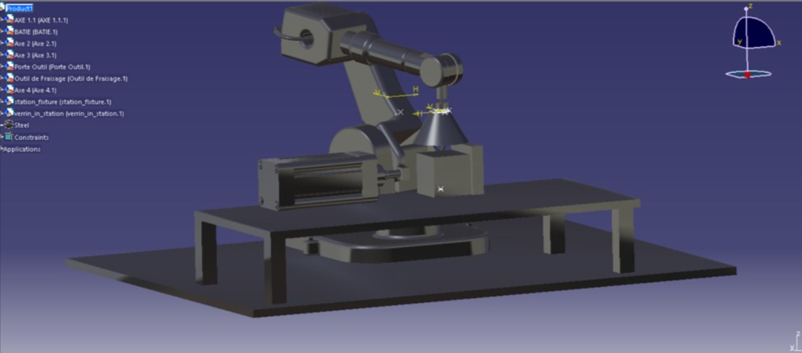

# Overview

The project covers the full chain from mechanical design to control logic and structural verification:

Design (CATIA V5): steel articulated robot, double-acting pneumatic clamping cylinder and fixture, assembled into one machining cell.
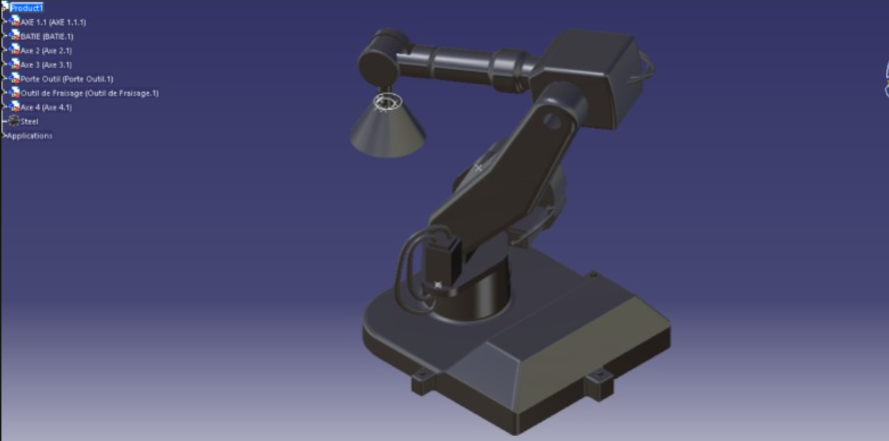

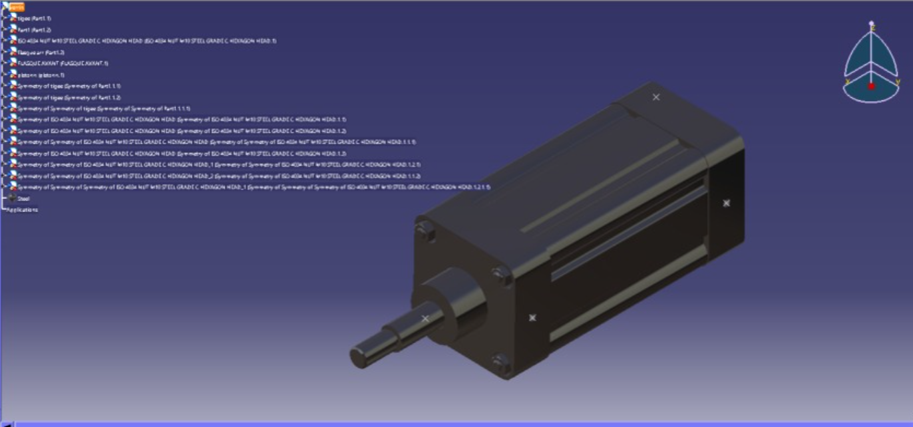

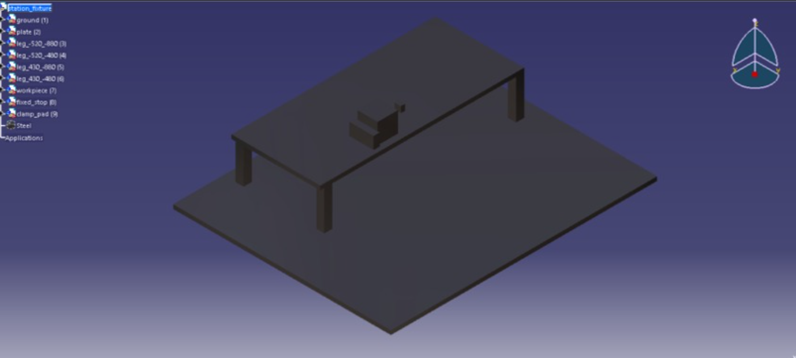

Sizing: clamping cylinder sized and checked against the estimated cutting force.

Control modeling (Stateflow / Simulink): clamp-and-mill cycle with a safety interlock, plus the clamp dynamics.

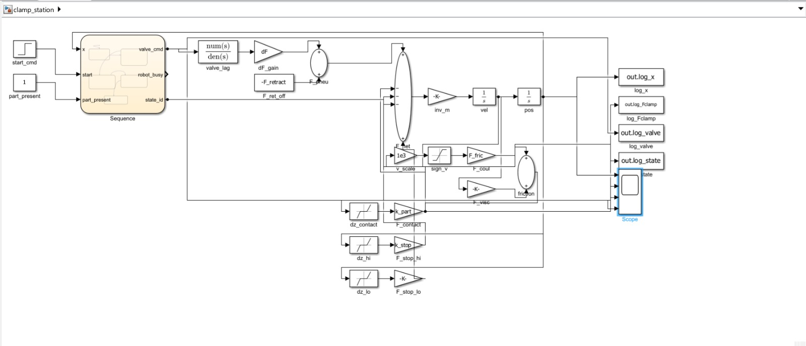

Structural analysis (ANSYS): static and fatigue FEA of the cylinder.

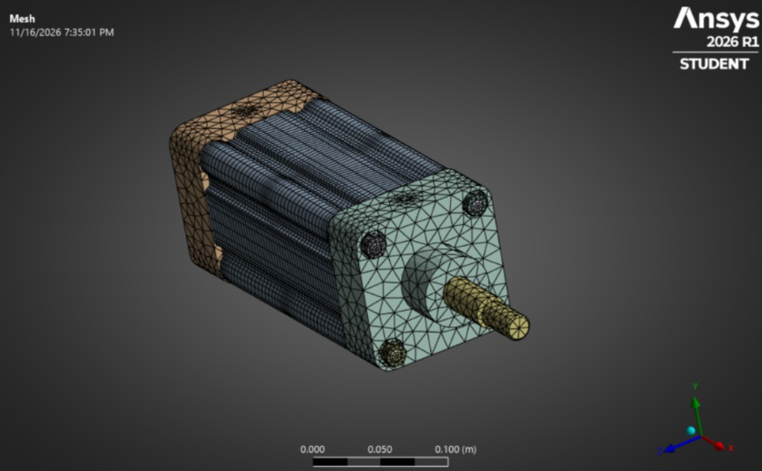

Key results
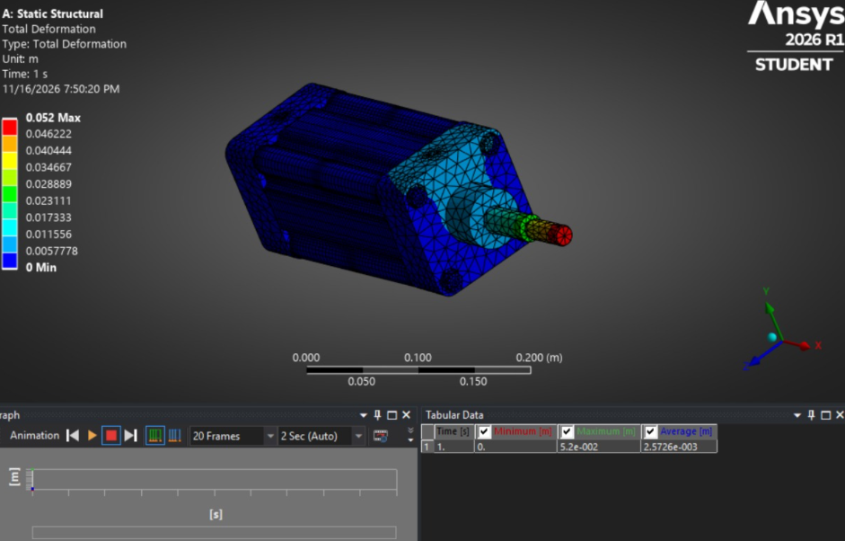

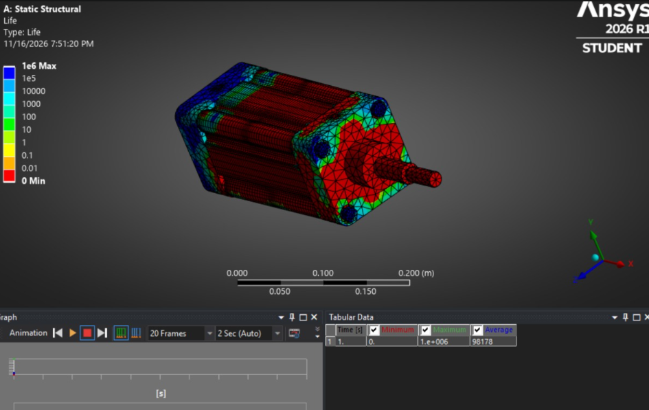

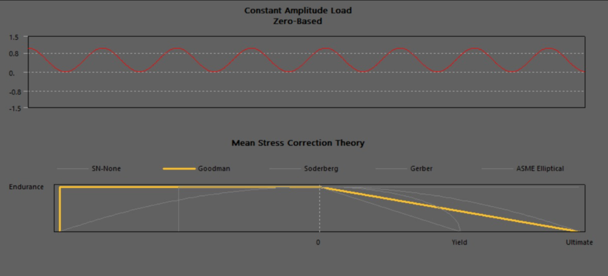

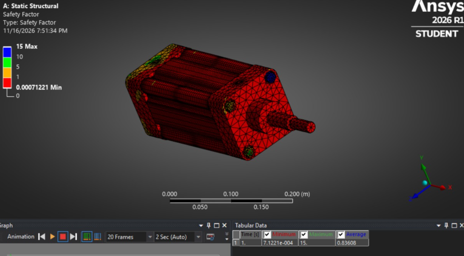

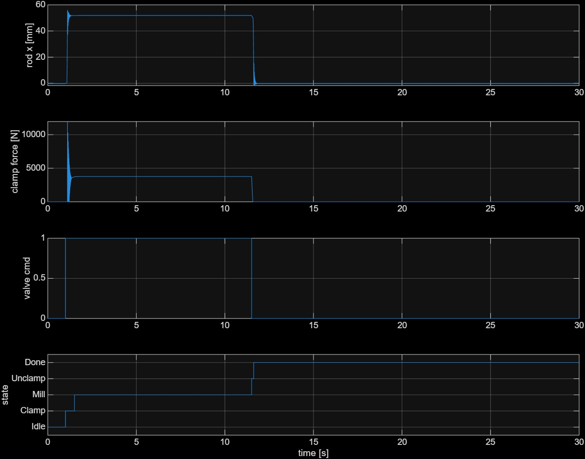

Item	Result
Cylinder	Ø100 mm bore, 6 bar supply
Theoretical clamp force	3.77 kN
Available clamp force	1.13 kN
Estimated cutting force	375 N
Clamp force margin	about 3×
Max von Mises stress (cylinder)	22.5 MPa (safety factor about 11)
Fatigue safety factor	6.4 at 10⁹ cycles
Robot kinematics	4 axes are enough for planar milling

# Control logic

The clamp-and-mill cycle is modeled as a 5-state Stateflow chart with a safety interlock: milling is authorized only once the clamp force has settled. The clamp dynamics are modeled in Simulink.

